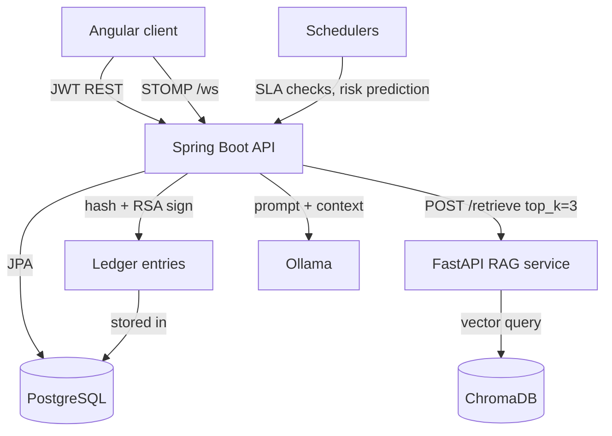

<div align="center">
  
  <h1>TickIT backend</h1>
  <p><em>Ticketing API for fiber installation cases, with STOMP notifications, a hash-chained audit ledger and a RAG fix-suggestion assistant.</em></p>


</div>

> Frontend: [tickit-ticketing-frontend](https://github.com/yassine-krichen/tickit-ticketing-frontend)

## Context

Built during my internship at Sofrecom Tunisie (Orange Group), February to June 2025, for the FTTH (fiber-to-the-home) installation team of roughly 40 people. The team tracked installation requests through email threads and shared files. TickIT replaces that with one system of record. The data in this repository is synthetic.

## What it does

An installation request moves through several phases (analysis, data retrieval, validation, assignment, treatment). In an email thread nobody can tell which phase a request is stuck in, who touched it last, or whether the deadline is at risk.

TickIT models each request as a case with treatment acts, tickets, activities and comments. Every state change is written to an append-only ledger where each entry stores the hash of the previous one and an RSA signature, so edits to history are detectable. Users get STOMP push notifications instead of polling. When a ticket is blocked, an assistant retrieves the three most similar past blockages from a ChromaDB index and asks a local LLM (Ollama) for a resolution suggestion.

The LLM runs locally because ticket text describes a telecom operator's network. The cost is latency: about 5.6 s per suggestion on CPU (see [measurements](measurements/METRICS.md)).

## Features

**Case and ticket management** — Cases, treatment acts, tickets, activities and comments with RSQL filtering, search, status counts and period statistics (`/api/v1/cases`, `/tickets`, `/treatments`).

**Role-based access** — JWT (HS512) authentication with five roles (`ROLE_USER`, `ROLE_PRODUCTEUR`, `ROLE_PILOTE`, `ROLE_DIRECTION`, `ROLE_ADMIN`); the same JWT is validated on the STOMP CONNECT frame.

**Real-time notifications** — STOMP over WebSocket at `/ws` with `/topic`, `/queue` and per-user destinations, plus persisted notifications with read, delete and paging endpoints.

**Tamper-evident audit trail** — `LedgerEntry` rows chained by SHA-256 hash from a `GENESIS` entry, each signed with `SHA256withRSA`; `/api/v1/ledger-entries/verification/blockchain` re-walks the chain.

**Fix-suggestion assistant** — Top-3 semantic retrieval over historical blockage records (`all-MiniLM-L6-v2` embeddings in ChromaDB), then a prompt to a local Ollama model; `POST /api/v1/ai/suggest/{ticketId}`.

**Blockage-risk alerts** — A scheduled job asks the LLM to rate treatment acts due within seven days and creates a notification for any rated above low risk.

**SLA automation** — Cron jobs flag overdue cases and response or resolution SLA breaches; schedules are configurable.

**Attachments** — Disk-backed file storage for ticket attachments with a size limit.

## How it works



### Key decisions

- **Top-3 retrieval over prompt stuffing**: ChromaDB with sentence-transformers over the previous approach of dumping five keyword-matched tickets into the prompt. Average prompt size drops from 612 to 244 tokens (-60%), with precision@1 of 18/20 on 20 queries against 90 synthetic blockage records.
- **Local LLM over a hosted API**: Ollama (`hermes3:3b`) over a cloud model because ticket content is operator network data. The price is 3.5 to 10.4 s per suggestion on a CPU.
- **Hash-chained, signed ledger over a plain audit table**: a table can be edited silently. A chain with signatures makes any edit detectable by walking it, without running a distributed ledger.
- **STOMP over raw WebSocket**: subscriptions, per-user destinations and message-level auth come from Spring, so there is no custom frame handling. Measured with k6: 30 concurrent clients, 100 events, 8 ms average and 35 ms P95 round trip, no drops.
- **Relational model**: PostgreSQL and Spring Data JPA, because cases, treatment acts and activities form a strict hierarchy that benefits from foreign keys and transactions.

## Tech stack

| Technology | Role | Why |
| --- | --- | --- |
| Spring Boot 2.5.9, Java 8 | REST API, WebSocket, schedulers | — |
| PostgreSQL, Spring Data JPA, RSQL | Persistence and filtering | RSQL gives clients composable filters without one endpoint per query |
| Spring Security, JJWT 0.9.1 | Authentication | — |
| MapStruct, Lombok | DTO mapping | — |
| STOMP over WebSocket | Notifications | — |
| FastAPI, ChromaDB, sentence-transformers | RAG service in `ai-module/` | Separate Python process, since the embedding stack is Python |
| Ollama | Local LLM | Data stays on the host |
| k6 | WebSocket load test | — |
| Springdoc OpenAPI | API docs | — |

## Getting started

### Prerequisites

- JDK 8 or newer, Maven wrapper included
- PostgreSQL
- Python 3.10+ and Ollama with `hermes3:3b`, only for the AI features

### Run

```bash
git clone https://github.com/yassine-krichen/tickit-ticketing-backend.git
cd tickit-ticketing-backend
cp .env.example .env   # fill in values, see Configuration
./mvnw spring-boot:run
```

The API listens on `http://localhost:8080`, WebSocket on `ws://localhost:8080/ws`.

### RAG service (optional)

```bash
cd ai-module
pip install -r requirements.txt
python ingest.py        # builds the ChromaDB index from data/blockage_records.json
python rag_service.py   # listens on :8001
```

Then set `rag.enabled=true` in `src/main/resources/application.properties`. With RAG disabled the assistant falls back to a database lookup.

### Test

```bash
./mvnw test
```

## Configuration

| Variable | Required | Description |
| --- | --- | --- |
| `SPRING_DATASOURCE_URL` | Yes | JDBC URL, e.g. `jdbc:postgresql://localhost:5432/tickit` |
| `SPRING_DATASOURCE_USERNAME` | Yes | Database user |
| `SPRING_DATASOURCE_PASSWORD` | Yes | Database password |
| `TICKIT_SECURITY_JWT_SECRET` | Yes | HS512 signing secret, at least 32 characters |
| `TICKIT_SECURITY_JWT_EXPIRATION_MS` | Yes | Token lifetime in milliseconds |
| `CRYPTO_PRIVATE_KEY` / `CRYPTO_PUBLIC_KEY` | Yes | RSA 2048 PEM pair used to sign and verify ledger entries |
| `TICKIT_AUTOMATION_*_SCHEDULE` | No | Cron expressions for overdue and SLA jobs |
| `TICKIT_STORAGE_UPLOAD_DIR`, `TICKIT_STORAGE_MAX_FILE_SIZE` | No | Attachment storage |
| `llm.endpoint`, `llm.model`, `rag.endpoint`, `rag.enabled` | No | Ollama and RAG service settings in `application.properties` |

`.env.example` lists the full set. Never commit a real `.env`.

## Key endpoints

`POST /api/v1/auth/signin` and `/signup` — JWT login and account creation.

`GET /api/v1/tickets` — paged, filterable ticket list; `GET /api/v1/tickets/stats/all` for dashboard counts.

`PUT /api/v1/tickets/{id}/status` — validated status transition.

`POST /api/v1/ai/suggest/{ticketId}` — RAG-assisted resolution suggestion.

`GET /api/v1/ledger-entries/verification/blockchain` — verifies the whole audit chain.

`GET /api/v1/notifications/paged` — persisted notifications; live ones arrive over `/ws`.

## Measurements

The numbers above come from files in this repository: [measurements/METRICS.md](measurements/METRICS.md), `ai-module/measure_rag.py`, `k6/websocket_load_test.js`.

## Roadmap

| Status | Item |
| --- | --- |
| Done | Case, treatment act and ticket workflow with RBAC |
| Done | STOMP notifications, SLA schedulers |
| Done | Signed hash-chained ledger |
| Done | RAG fix suggestions with local LLM |
| Planned | Replace the LLM-based risk rating with a model trained on case history |
| Planned | CI pipeline; integration tests for the ledger and WebSocket paths |

## License

**Source-available, not open source.** TickIT is published under the
[PolyForm Strict License 1.0.0](LICENSE) so you can read the code, run it, and learn
from it for personal, research, or evaluation use.

You may **not** use it commercially, redistribute it, rebrand it, or publish modified
versions without written permission. Copyright (c) 2025 Yassine Krichen. All rights
not granted by the license are reserved.

For commercial licensing or collaboration: krichenyassine22@gmail.com

Built by [Yassine Krichen](https://github.com/yassine-krichen)
