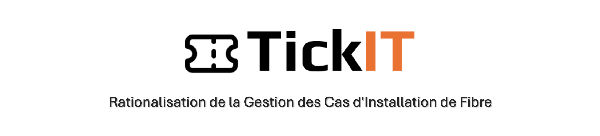
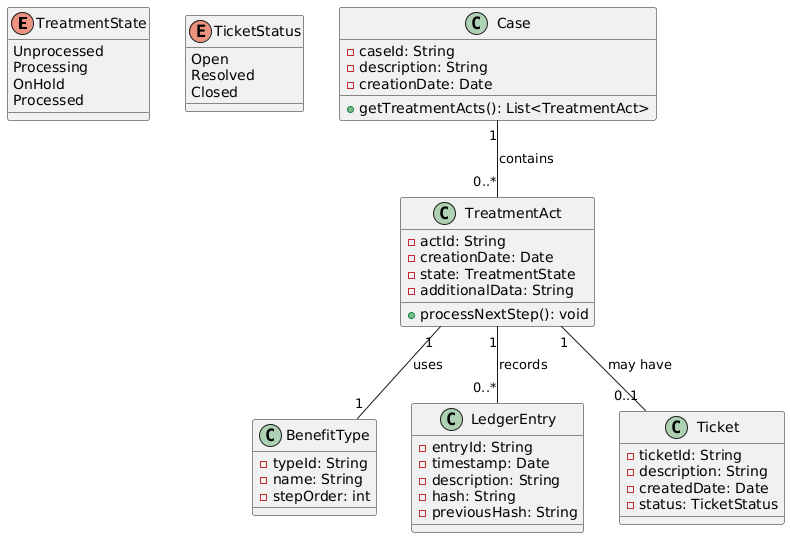
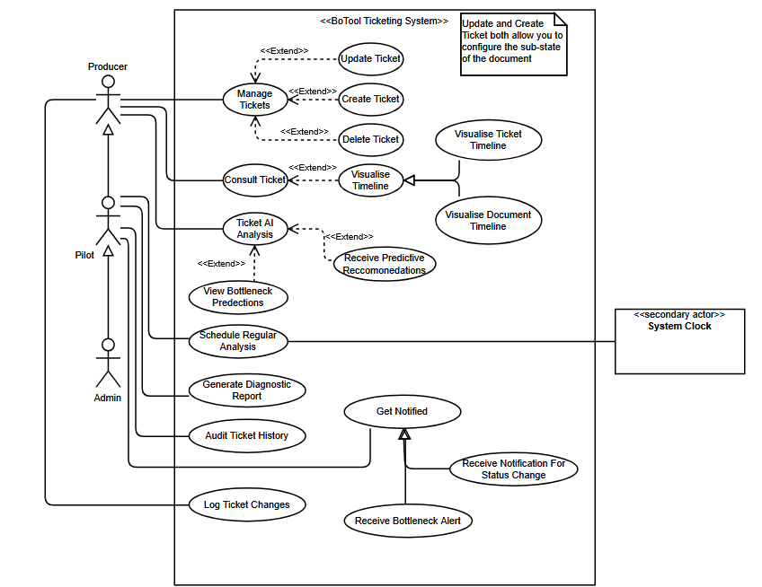

<div align="center">
  
  
  <p>
    
    
    
    
  </p>
</div>

## 📋 Table des matières
- [À propos du projet](#à-propos-du-projet)
- [Problématique](#problématique)
- [Notre Solution](#notre-solution)
- [Fonctionnalités](#fonctionnalités)
- [Architecture](#architecture)
- [Interface Utilisateur](#interface-utilisateur)
- [Installation](#installation)
- [Structure du Projet](#structure-du-projet)
- [Contribution](#contribution)
- [Licence](#licence)
- [Contact](#contact)

## 🎯 À propos du projet
TickIT est un module de gestion de tickets développé par Sofrecom Tunisie pour améliorer le processus de traitement des demandes d'extension fibre d'Orange France. Ce projet s'intègre avec BoTool, une application existante utilisée pour le traitement des dossiers de demande.

### Contexte
Orange France propose des connexions fibre, et les clients peuvent demander une extension pour une connexion internet plus rapide en soumettant un dossier de demande ("case"). Ces demandes sont traitées par Sofrecom Tunisie via l'application BoTool.

### Situation Actuelle
Face à l'identification de nouveaux besoins et d'améliorations potentielles, TickIT a été développé comme un nouveau module pour moderniser BoTool. Ce module se concentre particulièrement sur la gestion des blocages et la traçabilité des actions pendant le traitement des dossiers.

### Objectifs
- Améliorer la visibilité sur l'état des dossiers
- Optimiser la gestion des blocages
- Réduire les pertes de temps
- Augmenter la satisfaction client
- Faciliter la facturation
- Améliorer l'efficacité globale du processus

## ⚠️ Problématique
Les entreprises font face à plusieurs défis dans la gestion du support client :
- Manque de traçabilité des demandes
- Difficulté de priorisation des tickets
- Communication inefficace entre les équipes
- Temps de résolution prolongés
- Absence de métriques de performance

## 💡 Notre Solution
TickIT apporte une solution innovante pour la gestion des blocages dans le traitement des dossiers fibre d'Orange France. Notre approche combine des technologies modernes et des fonctionnalités avancées pour résoudre les problèmes de traçabilité et d'efficacité :

- **Subdivision Granulaire des Statuts** : Affinage de l'état "en traitement" en sous-états détaillés pour une identification précise des blocages
- **Suivi Visuel Avancé** : Interface dynamique avec barres de progression et vues chronologiques
- **Intelligence Artificielle** : Analyse prédictive des goulots d'étranglement basée sur l'historique
- **Traçabilité Blockchain** : Enregistrement immuable des actions et transitions
- **Intégration Transparente** : Connexion fluide avec BoTool et autres systèmes

## ✨ Fonctionnalités

### 🎯 Gestion des Statuts
- **États Granulaires**
  - Découpage précis des étapes de traitement
  - Identification instantanée des blocages
  - Suivi des sous-états en temps réel

### 📊 Tableau de Bord Intelligent
- **Visualisation Dynamique**
  - Barres de progression
  - Statuts codés par couleur
  - Vues chronologiques détaillées
- **KPIs Personnalisables**
  - Temps de traitement par étape
  - Taux de blocage
  - Performance des équipes

### 🤖 Intelligence Artificielle
- **Analyse Prédictive**
  - Détection des motifs de retard
  - Prédiction des goulots d'étranglement
  - Recommandations d'optimisation

### 🔗 Traçabilité Blockchain
- **Audit Trail**
  - Enregistrement immuable des actions
  - Historique complet des transitions
  - Transparence totale du processus

### 🔔 Système de Notifications
- **Alertes Intelligentes**
  - Notifications de blocage prolongé
  - Alertes de performance
  - Rappels automatiques

### 🔄 Intégration
- **Connectivité**
  - API REST robuste
  - Intégration avec BoTool
  - Synchronisation en temps réel

## 🏗 Architecture

### Diagramme de Classes


### Diagramme de Cas d'Utilisation


## 🎨 Interface Utilisateur (En cours)
<!-- ### Dashboard


### Création de Ticket


### Vue détaillée
 -->

## 🚀 Installation

1. Cloner le repository
```bash
git clone git@example.com:tickit.git
```

2. Configurer la base de données
```bash
# Se connecter à PostgreSQL
psql -U postgres

# Créer la base de données
CREATE DATABASE tickit;

# Lister toutes les bases de données pour vérifier
\l 

# Donner les privilèges à l'utilisateur postgres
GRANT ALL PRIVILEGES ON DATABASE tickit TO postgres;

# Se connecter à la base de données tickit
\c tickit
```

3. Configurer les variables d'environnement
```bash
# Éditer .env avec vos configurations
# Pas de variables env pour le moment 
```

4. Lancer l'application
```bash
mvn spring-boot:run
```
Ou bien, clicker sur `Run` sur la méthode main dans `TickItTicketingSystemApplication.java`

## 📁 Structure du Projet

```
src/main/java/com/sofrecom/tickit/
├── config/          # Classes de configuration Spring Boot
├── controller/      # Contrôleurs REST
├── model/           # Entités JPA
│   └── enum/        # Énumérations
├── dto/             # Objets de transfert de données
├── repository/      # Interfaces JPA Repository
├── service/         # Interfaces des services
├── impl/            # Implémentations des services
├── security/        # Configuration de sécurité
└── util/            # Classes utilitaires
```

## 👥 Contribution
Ce projet est privé et réservé aux développeurs autorisés. Pour contribuer :
1. Créer une branche pour votre fonctionnalité
2. Commiter vos changements
3. Créer une merge request

## 📄 Licence
Ce projet est propriétaire et appartient à Sofrecom. Tous droits réservés © 2025 Sofrecom.

## 📧 Contact
Pour toute question ou support :
- Yassine Krichen : yassine.krichen@sofrecom.com
- Talel Turki : talel@example.com

---

<div align="center">
  <p>Développé avec passion par l'équipe stagiaire Sofrecom</p>
  <p>© 2025 Sofrecom. Tous droits réservés.</p>
</div>

