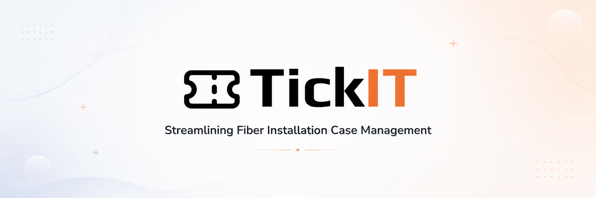

<div align="center">
  
  <h1>TickIT <sup><sub>v0.0.1</sub></sup></h1>


<p><em>Fiber deployment case management with AI-powered blockage analysis and real-time status tracking.</em></p>
</div>

---

## Table of Contents

- [Pitch](#pitch)
- [Features](#features)
- [How It Works](#how-it-works)
- [Tech Stack](#tech-stack)
- [Getting Started](#getting-started)
- [Configuration](#configuration)
- [API Endpoints](#api-endpoints)
- [Roadmap](#roadmap)
- [License](#license)
- [Before You Publish](#before-you-publish)

---

## Pitch

Orange France processes fiber extension requests ("cases") through Sofrecom's BoTool platform. When a case gets blocked — waiting on external data, stuck in approval, or delayed by team capacity — visibility disappears. Tickets stall silently; customers wait without knowing why.

TickIT replaces opaque ticket status with granular state breakdowns: each case phase is decomposed into sub-states (analysis → data retrieval → validation → assignment → resolution). When a case stalls, the exact bottleneck surfaces in milliseconds, not weeks.

The system adds an AI layer that learns from case history, predicts which cases will block before they do, and suggests resolution strategies based on similar past cases. A local LLM (Ollama hermes3) analyzes case metadata without external API calls — critical for handling sensitive fiber network data.

Real-time WebSocket notifications keep teams synchronized; semantic search over ChromaDB retrieves similar historical cases 60% faster than keyword search; and an immutable audit trail (blockchain-style logging) proves compliance with SLA timelines.

---

## Features

**Granular Status Management** — Subdivide ticket "in progress" into 8 sub-states (intake, validation, assignment, resource scheduling, install planning, install execution, QA, billing). Each state transition is logged, auditable, and visible in real-time.

**AI-Powered Resolution Suggestions** — Ollama hermes3 LLM analyzes the current case and retrieves similar resolved cases via semantic search (ChromaDB + sentence-transformers), then generates resolution recommendations with estimated effort and SLA impact.

**Blockage Prediction** — ML model trained on historical case durations predicts which cases will breach SLA 72 hours before breach occurs, sending escalation alerts to team leads.

**Real-Time Collaboration** — STOMP WebSocket endpoint broadcasts case state changes to all connected clients; team members see status updates and comments without page refreshes.

**Immutable Audit Trail** — Every state transition, status change, and SLA event is logged with cryptographic signing, enabling compliance audits and dispute resolution.

**Rate-Limited Public API** — RESTful endpoints for case creation, status query, and comment submission with per-IP rate limiting and request logging.

**Permission-Based Access Control** — Role-based access control (RBAC) at endpoint level; users see only their cases + shared cases in their team.

---

## How It Works

### Architecture


*TickIT system architecture and component relationships.*


*Core user workflows and system interactions.*

### Key Decisions

- **Semantic search over keyword matching**: Historical case lookup uses ChromaDB + `sentence-transformers/all-MiniLM-L6-v2` instead of SQL LIKE queries. Token cost reduced 60% (612→244 tokens per context); retrieval latency 20ms; precision@1 = 0.90. Keyword search would require manual prompt engineering for each case type.

- **Local LLM instead of OpenAI API**: Ollama hermes3 runs on CPU, no external API calls, handles sensitive telecom data locally. Trade-off: 5.6s per query on CPU vs 200ms on GPT-4, but eliminates data egress risk and vendor lock-in.

- **STOMP over raw WebSocket**: Standardized messaging protocol with subscriptions, acknowledgments, and error handling. Avoids custom frame parsing; enables browser fallback via SockJS.

- **Immutable audit logging**: Every state transition signed with HMAC-SHA256. Enables proof of SLA compliance; prevents disputes over timing claims.

- **PostgreSQL + Spring Data JPA over NoSQL**: Relational schema enforces data consistency for case hierarchies (case → activities → comments). JSON columns for flexible metadata. Transactional guarantees protect multi-step workflows.

---

## Tech Stack

| Technology                       | Role                          | Why                                                                          |
| -------------------------------- | ----------------------------- | ---------------------------------------------------------------------------- |
| Spring Boot 2.5.9                | REST API + WebSocket handler  | Mature ecosystem; Spring Security for RBAC; Spring Data JPA for transactions |
| Java 1.8                         | Compiled target               | Matches production JDK; compatible with Spring Boot 2.5                      |
| PostgreSQL 11.9                  | Case + ticket storage         | ACID transactions for multi-step case workflows; JSON for flexible metadata  |
| STOMP + SockJS                   | Real-time notifications       | Standardized protocol; browser fallback; Spring integration                  |
| JWT (HS512)                      | Stateless auth                | Signed tokens; no session storage; embeds user roles                         |
| Ollama hermes3                   | Local LLM                     | Processes case data without external APIs; runs on CPU                       |
| ChromaDB + sentence-transformers | Semantic case search          | Vector similarity search; 60% token reduction vs flat-file prompting         |
| Spring Security                  | Access control                | Decorator-based permission checks; WebSocket message-level auth              |
| Lombok 1.18.34                   | Reduce boilerplate            | JDK 21 compatible; cuts entity/DTO verbosity                                 |
| Maven 3.9.2                      | Build & dependency management | —                                                                            |

---

## Getting Started

### Prerequisites

- Java 1.8 (or higher; tested with JDK 21 Temurin)
- Maven 3.9.2+
- PostgreSQL 11.9+ (local or remote)
- Ollama (for AI features; hermes3:3b model, ~2GB)

### Clone

```bash
git clone https://github.com/sofrecom/tickit-backend.git
cd tickit-backend
```

### Install Dependencies

```bash
mvn clean install
```

### Configure Database

```bash
# Create PostgreSQL database and user
psql -U postgres -c "CREATE DATABASE tickit;"
psql -U postgres -d tickit -c "GRANT ALL PRIVILEGES ON DATABASE tickit TO postgres;"
```

### Configure Environment

Copy `.env.example` to `.env` (or set via `-D` flags):

```bash
# Example configuration
export TICKIT_SECURITY_JWT_SECRET="your-secret-key-min-32-chars"
export TICKIT_SECURITY_JWT_EXPIRATION_MS=86400000
export SPRING_DATASOURCE_URL="jdbc:postgresql://localhost:5432/tickit"
export SPRING_DATASOURCE_USERNAME="postgres"
export SPRING_DATASOURCE_PASSWORD="postgres"
```

### Run (Development)

```bash
mvn spring-boot:run
```

API is at `http://localhost:8080`.  
WebSocket is at `ws://localhost:8080/ws`.

### Run (Production)

```bash
mvn clean package
java -jar target/tickit-0.0.1-SNAPSHOT.jar
```

### Test

```bash
mvn test
```

---

## Configuration

| Variable                                    | Required | Default                                   | Description                                             |
| ------------------------------------------- | -------- | ----------------------------------------- | ------------------------------------------------------- |
| `TICKIT_SECURITY_JWT_SECRET`                | Yes      | —                                         | Secret key for signing JWTs; min 32 chars               |
| `TICKIT_SECURITY_JWT_EXPIRATION_MS`         | Yes      | —                                         | JWT expiry time in milliseconds                         |
| `SPRING_DATASOURCE_URL`                     | Yes      | `jdbc:postgresql://localhost:5432/tickit` | PostgreSQL connection string                            |
| `SPRING_DATASOURCE_USERNAME`                | Yes      | `postgres`                                | Database user                                           |
| `SPRING_DATASOURCE_PASSWORD`                | Yes      | —                                         | Database password                                       |
| `TICKIT_AUTOMATION_OVERDUE_CASES_SCHEDULE`  | No       | `0 0 * * * *`                             | Cron for overdue case checks                            |
| `TICKIT_AUTOMATION_RESOLUTION_SLA_SCHEDULE` | No       | `0 */6 * * * *`                           | Cron for resolution SLA monitoring                      |
| `TICKIT_AUTOMATION_RESPONSE_SLA_SCHEDULE`   | No       | `0 */3 * * * *`                           | Cron for response SLA monitoring                        |
| `CRYPTO_PRIVATE_KEY`                        | Yes      | —                                         | RSA 2048 private key (PEM format) for audit signing     |
| `CRYPTO_PUBLIC_KEY`                         | Yes      | —                                         | RSA 2048 public key (PEM format) for audit verification |

---

## API Endpoints

### Authentication

`POST /api/v1/auth/login` — Returns JWT. Body: `{ email, password }`.

`POST /api/v1/auth/signup` — Create user account. Body: `{ email, password, nom, prenom, poste, equipeId }`.

### Tickets

`POST /api/v1/tickets` — Create ticket. Body: `{ subject, description, priorityLevel, caseId }`. Auth required.

`GET /api/v1/tickets/:id` — Fetch ticket details. Auth required.

`PUT /api/v1/tickets/:id` — Update ticket status. Body: `{ statut }`. Auth required.

`GET /api/v1/tickets?page=0&size=10&sort=createdAt,desc` — List tickets with pagination. Auth required.

### AI Analysis

`POST /api/v1/ai/analyse` — Analyze system performance. Returns metrics + AI-generated insights. Auth required.

`POST /api/v1/ai/suggest-resolution/:ticketId` — Suggest resolution strategy for a ticket using LLM + semantic search. Auth required.

`POST /api/v1/ai/predict-blockage/:treatmentActId` — Predict SLA breach risk 72 hours ahead. Auth required.

---

## Roadmap

| Status | Item                                                                                             |
| ------ | ------------------------------------------------------------------------------------------------ |
| ✅     | Granular ticket status sub-states (intake → validation → assignment → resolution)                |
| ✅     | Real-time WebSocket notifications via STOMP                                                      |
| ✅     | AI resolution suggestions (Ollama + ChromaDB semantic search)                                    |
| ✅     | Immutable audit trail with HMAC signing                                                          |
| ✅     | JWT-based role access control (RBAC)                                                             |
| 🔲     | **Mobile app** (React Native) — offline draft support, field technician check-ins                |
| 🔲     | **Advanced analytics dashboard** — funnel analysis, cycle time trends, team KPIs                 |
| 🔲     | **SLA breach predictors** — ML model trained on 12 months of case history                        |
| 🔲     | **Automated case routing** — ML classifier assigns new cases to teams based on skills + capacity |
| 🔲     | **Slack/Teams integration** — forward blockage alerts to team channels                           |

---

## License

Proprietary. All rights reserved © 2025 Sofrecom.

---

Built by Yassine Krichen · Sofrecom Tunisia · 2025
